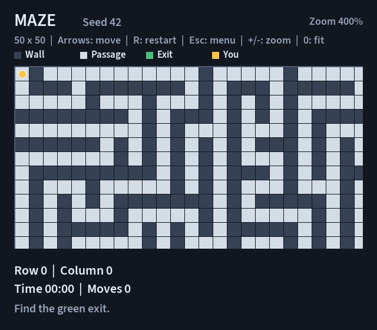

# NXRP Maze

A Windows maze game built with C++17 and SFML 3.1.0. Choose a grid from 10 to
50 rows and columns, move with the arrow keys, and reach the green exit.



## Requirements

- Windows and Visual Studio 2026 with **Desktop development with C++**, the
  **MSVC v145 x64** toolset, a Windows SDK and the C++ native unit test tools.
- Git and CMake **4.2 or later** for the Visual Studio 18 2026 dependency generator.
- Internet access for the first SFML download.

The repository contains four standard Visual Studio projects. Open
**NXRP.slnx**, rather than the generated SFML solution inside `build/`.
CMake prepares the third-party library only.

## First setup

From **Command Prompt** in your checkout, run:

```bat
cd /d C:\Users\rafat\source\repos\NXRP
powershell.exe -NoProfile -ExecutionPolicy Bypass -File .\Prepare-Dependencies.ps1
```

Replace the checkout path if yours differs. The script downloads and builds
static SFML graphics/window/system libraries for Debug and Release, then creates
configuration-specific property sheets in `build/dependencies/`. It leaves
the four application projects under Visual Studio's control. Run it again after
moving the checkout or deleting `build/`.

## Build and run in Visual Studio

1. Open **NXRP.slnx** with **File > Open > Project/Solution**.
2. Select **Debug / x64**.
3. Right-click **Maze.Graphics > Set as Startup Project**.
4. Choose **Build > Build Solution**, then **F5** or **Ctrl+F5**.

The executable is `build/bin/Debug/Maze.Graphics.exe`. Release builds go to
`build/bin/Release/`. Each build copies `assets/` beside the executable. The
font path starts at the actual executable directory, so another working
directory does not break resource loading.

For command-line builds, use **Developer Command Prompt for VS 2026**:

```bat
MSBuild NXRP.slnx /p:Configuration=Debug /p:Platform=x64
build\bin\Debug\Maze.Graphics.exe
```

## Controls and rules

| Control or menu item | Behavior |
| --- | --- |
| Arrow keys | Move one cell per press. Walls and outer boundaries block movement. |
| Mouse wheel / + / - | Zoom between 100% and 400%. The wheel works over the board. The view follows the player. |
| 0 / Home | Fit the entire maze into the board area. Numpad +, -, and 0 also work. |
| Escape during play | Pause and open the main menu. |
| Continue | Resume the same maze and position. Available only for an unfinished session. |
| New Game | Generate a maze using the selected dimensions and seed/mode, then start at `(0, 0)`. Replaces any previous session. |
| Restart maze / R | Start the same maze again at `(0, 0)`. Available during play, from the main menu and after victory. Keeps its layout/seed and the next-game preferences. The shortcut is inactive on Help and Settings. |
| How to Play | Show the rules. Back or Escape returns to the main menu. |
| Settings | Choose rows/columns and an optional seed, then **Apply**. Cancel or Escape discards the draft. |
| Exit or window close | Release the current maze and close the application. |

The yellow player starts at the top-left passage. The green exit is at
`(rows - 1, columns - 1)`. Reaching it opens the victory page, where **Restart maze**
replays the same layout, **New Game** generates another maze and **Main menu**
returns to the menu. Continue is disabled after victory. Restart maze is disabled
until a session exists, and it becomes available again for a completed maze.

Settings apply to the **next New Game**. Continue keeps the existing grid.
Settings persist between launches in `%LOCALAPPDATA%\NXRP\settings.txt` for the
current Windows user. **Apply** writes both dimensions. Missing, unreadable
or malformed preferences use 10 by 10. If saving fails, the size still applies
to New Game for this launch, and the menu explains that it could not save it.
The file contains two integers: rows followed by columns. Both must be 10–50,
with no extra data other than whitespace. Closing the game and deleting this
specific file restores the defaults on the next launch. The maze and player
position remain in memory only.

The current seed is shown beside MAZE and on the victory page. To replay a
layout, choose the same rows/columns in Settings, click the Seed field, enter
its decimal seed, press Apply, then New Game. Valid seeds are 0 through
4294967295, including zero. Leave the field empty for random generation.
Backspace edits, Delete clears and Ctrl+V replaces the field with clipboard text.
Enter applies valid settings. Invalid input disables Apply and shows the range.

The seed choice lasts for this launch. Only dimensions are saved to disk.
New Game uses the selected seed/mode; Restart keeps the current grid and seed.
Changing Settings while paused affects the next New Game and preserves the
current maze. Replay requires the same generator/toolchain as well as the same
seed and dimensions.

The game display shows elapsed time and successful moves. Time runs only while
Playing, pauses across the main menu/Help/Settings, and freezes when the exit is
reached. The victory page shows the final results. Blocked requests do not add
moves; the winning step counts once. New Game and Restart reset both statistics,
while Continue preserves them. Time uses total minutes and two-digit seconds.

The board initially fits the window, including a 50 by 50 maze at the minimum
supported size of 640 by 560. Zoom clips the board to its own area, keeping the
controls, coordinates and statistics visible. Continue retains zoom. New Game
and Restart return to the full-map view. Resizing retains the zoom level and
keeps the player's cell visible. Zoom changes no maze cells or move counts.

## Projects and files

| Project or path | Purpose |
| --- | --- |
| `Maze.Data/` | Static library containing grid ownership, cells, dimensions, positions and game state. |
| `Maze.Logic/` | Static library containing validation, generation, movement and session operations. Depends on Data. |
| `Maze.Graphics/` | SFML application, event loop, menu pages, controller, board rendering and resource paths. Depends on Logic and Data. |
| `Maze.UnitTest/` | Microsoft Native Unit Test DLL using Data/Logic and the SFML-free camera calculations. |
| `ProjectDefaults.props` | Shared C++17 compiler settings and output directories. |
| `dependencies/` | CMake setup for SFML 3.1.0 and the generated property-sheet template. |
| `assets/fonts/` | Bundled Source Sans 3 Semibold font and its license. |
| `QA/` | Feature-based Excel cases and archived regression evidence. |
| `docs/` | Technical documentation, algorithm diagrams and defense presentation. |

Add source files with **Add > New Item / Existing Item** in the relevant project.
Include the resulting `.vcxproj` and `.vcxproj.filters` changes in your commit.
Build products, dependency downloads and `.vs/` caches stay ignored.

The `Maze.*` folders above contain the maintained source projects. `build/`
contains generated outputs and the SFML dependency build; it is recreated by
the setup script and Visual Studio. The `.vcxproj` files in the source folders
stay in Git. Adding application files through Visual Studio does not require
regenerating the solution with CMake.

## Native unit tests

Build the solution, then open **Test > Test Explorer > Run All**. The 109 tests
belong to `MazeSizeTests`, `MazeGridTests`, `GameStateTests`,
`MazeMovementTests`, `MazeGenerationTests`, `MazeSessionTests`, `MazeSettingsTests`,
`GameStatisticsTests`, `MazeSeedTests` and `MazeViewportTests`.

`Maze.UnitTest` is a **Native Unit Test Project** created in Visual Studio. It
uses `CppUnitTest.h`, `TEST_CLASS`, `TEST_METHOD` and `Assert`. Its output is a
DLL for the native adapter to load. Run the game project with F5, and run tests
through Test Explorer or VSTest.

To repeat both configurations in **Developer Command Prompt for VS 2026**:

```bat
MSBuild NXRP.slnx /p:Configuration=Debug /p:Platform=x64
"%VSINSTALLDIR%Common7\IDE\CommonExtensions\Microsoft\TestWindow\vstest.console.exe" build\bin\Debug\Maze.UnitTest.dll /Platform:x64 /Logger:trx /ResultsDirectory:build\TestResults\Debug
MSBuild NXRP.slnx /p:Configuration=Release /p:Platform=x64
"%VSINSTALLDIR%Common7\IDE\CommonExtensions\Microsoft\TestWindow\vstest.console.exe" build\bin\Release\Maze.UnitTest.dll /Platform:x64 /Logger:trx /ResultsDirectory:build\TestResults\Release
```

The suite checks ownership and bounds, movement and victory, session replacement/restart,
preference round-trips, malformed/unwritable files, game time and successful moves,
fixed-seed repeatability, camera bounds/player tracking and independently verified
reachability for all 1,681 allowed size pairs. [QA results](QA/README.md) distinguish CLI runs, UI observations
and checks that remain unrun. [Final validation](docs/VALIDATION.md) records the
documentation-stage rebuild and subsequent feature checks.

## Documentation

- [Technical documentation](docs/TECHNICAL.md): architecture, data and memory,
  generation, movement, session lifecycle, test design and where to add features.
- [Algorithm diagrams](docs/ALGORITHMS.md): generation, movement, ownership,
  game phases, elapsed time and camera calculations.
- [Defense presentation](docs/NXRP_Defense.pptx): 10 editable slides with speaker notes,
  covering preferences, restart, statistics, seed replay, zoom and current QA evidence.
- [Presenter notes](docs/PRESENTATION_NOTES.md): matching slide notes and a verified
  10 by 10, seed-zero demonstration route.

The latest QA pass records **109/109 Native tests in each x64 configuration**.
Its workbook has 139 cases: 136 Passed, 0 Failed and 3 Not Run, with current
Native/controller results separated from the original GUI observations.
The pending manual/environment checks are listed in the QA guide.

## Troubleshooting

| Symptom | Action |
| --- | --- |
| Missing `NXRP.SFML.Debug.props` or SFML headers/libraries | Run the dependency preparation script for the chosen configuration. |
| v145 toolset or native test framework missing | Modify the Visual Studio installation to include the C++ desktop toolchain and native test tools. |
| Font fails to load at startup | Rebuild Maze.Graphics and keep the copied `assets/fonts/SourceSans3-Semibold.ttf` beside the executable. The console prints the failed path. |
| Size applies only to this launch | Check write access to `%LOCALAPPDATA%\NXRP\`. The game keeps the chosen size in memory when saving fails. |
| Tests do not appear | Build Maze.UnitTest in x64, check the C++ native test adapter, then reopen Test Explorer. The VSTest command above provides a separate diagnostic. |
| `Set-Location` is not recognized | That command belongs to PowerShell. In Command Prompt use `cd /d` as shown above. |

## Team

RMKolibarov24, HAMihaylov24, PDKapralev24 and NKPeshev24.
See the [technical documentation](docs/TECHNICAL.md#team-responsibilities) for
the confirmed development responsibilities.
