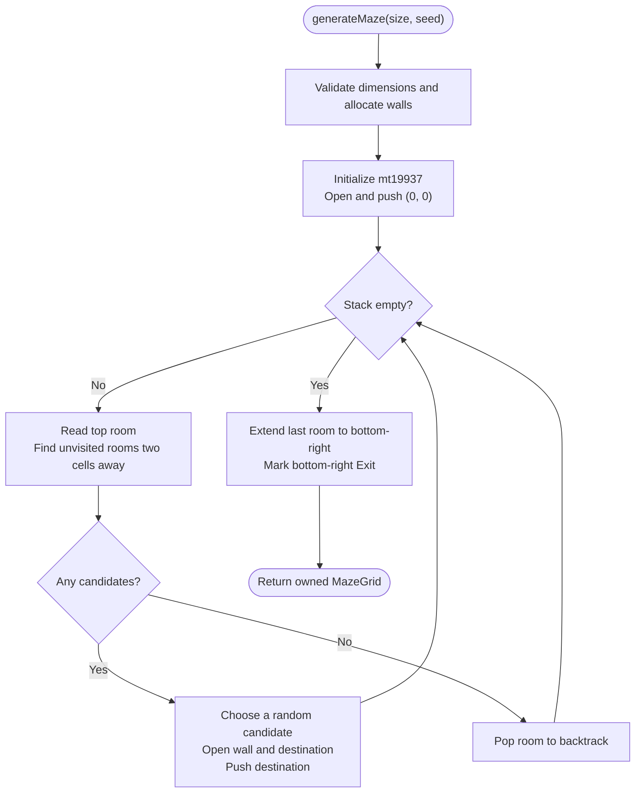
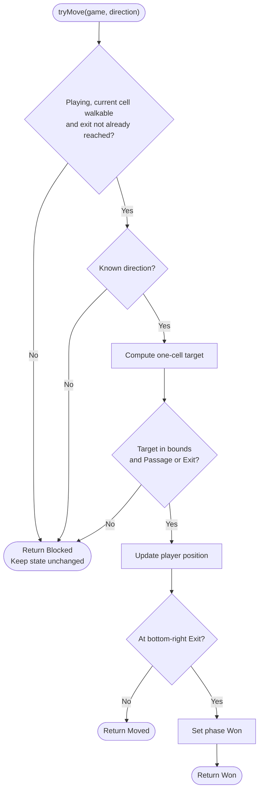
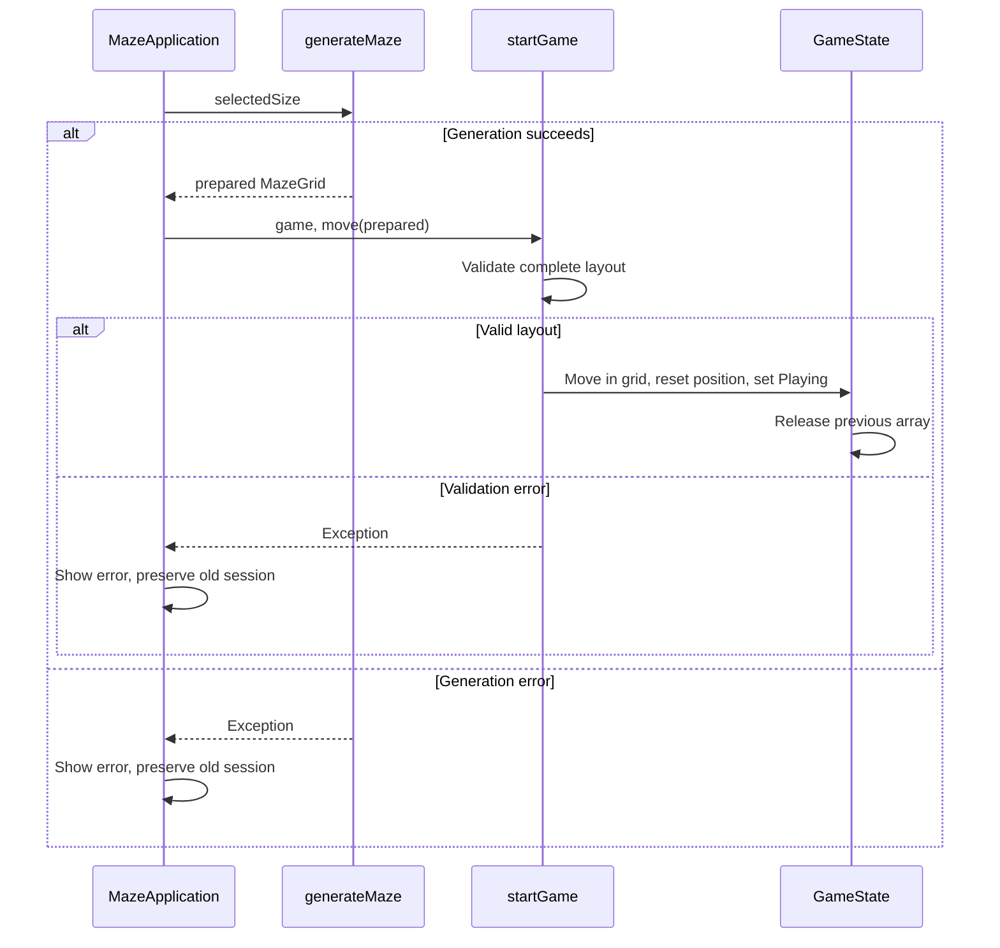

# Algorithm diagrams

These Mermaid flowcharts describe the implemented functions and render directly
on GitHub. The defense presentation also contains an editable generation diagram.

## Maze generation

Implementation: `Maze.Logic/Maze.Generation.cpp`, `generateMaze(size, seed)`.

Invalid dimensions throw before allocation. Unvisited rooms still contain Wall.
Every stack entry has even row and column indices. A completed grid contains
one Exit at `(rows - 1, cols - 1)`. Time and auxiliary stack space are
O(rows * cols).

For 10 by 10, the last room is `(8, 8)`. The extension opens `(9, 8)` and `(9, 9)`
and marks `(9, 9)` Exit. For 11 by 11, the last room is already `(10, 10)`, which
becomes Exit without an extra corridor.

## Movement

Implementation: `Maze.Logic/Maze.Game.cpp`, `tryMove`.

All checks that can reject a move precede the position update. Movement takes
O(1) time and uses no grid allocation.

## New Game ownership

The rvalue reference parameter alone does not transfer ownership. startGame
performs the move only after layout validation succeeds.
