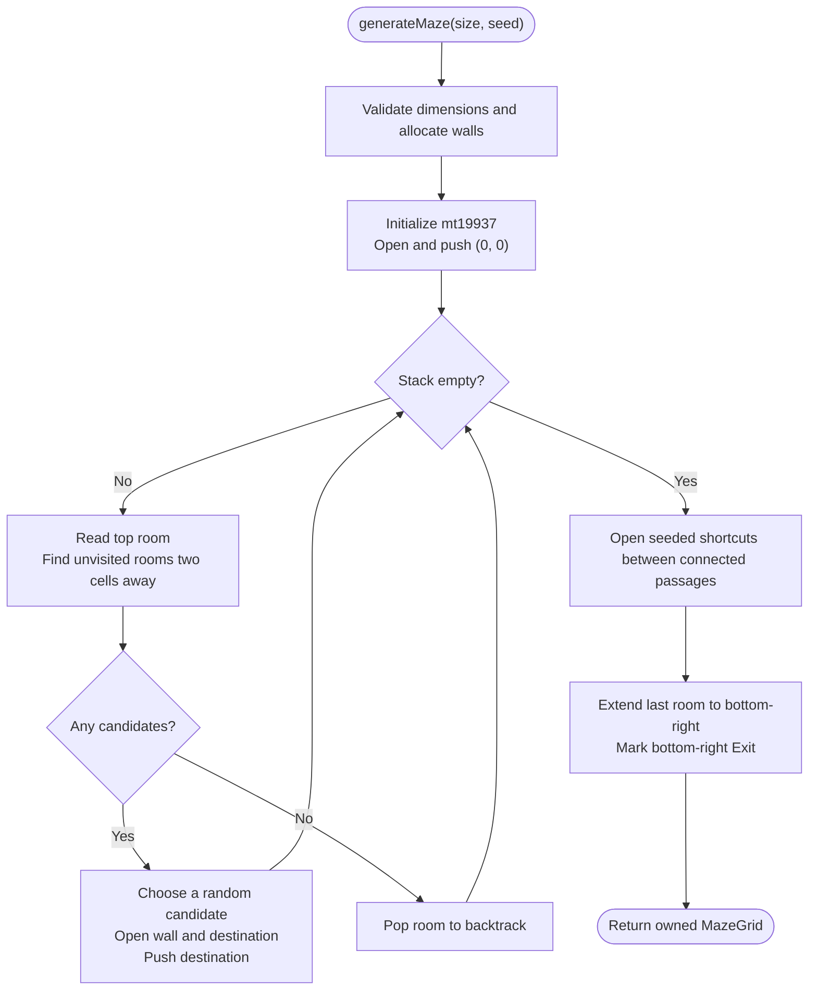
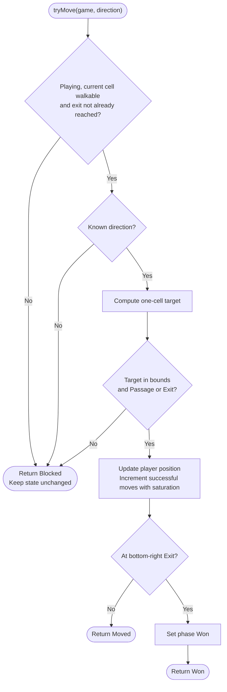
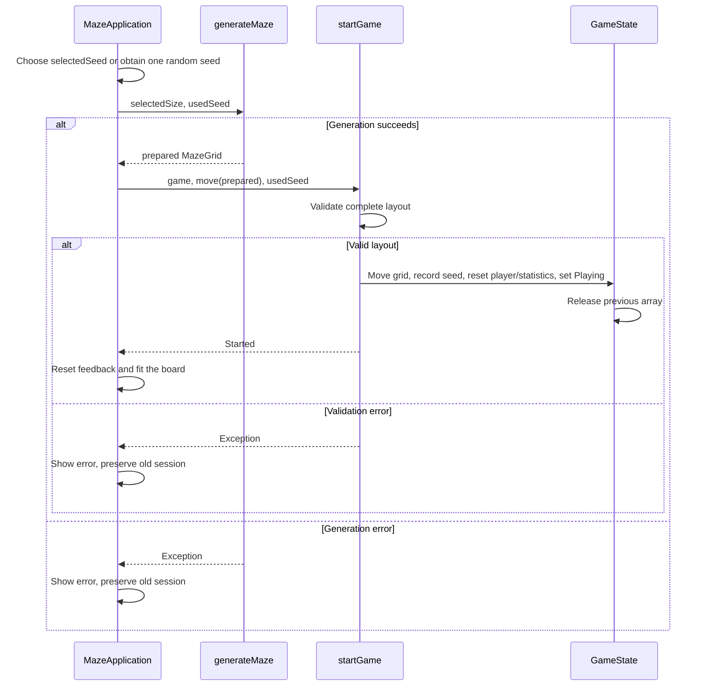
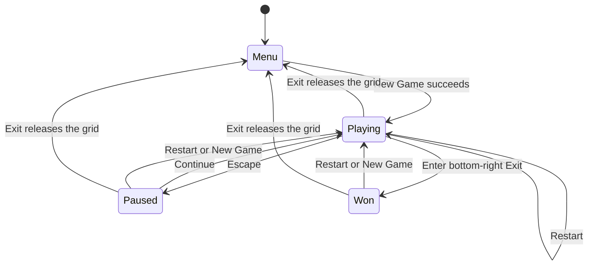
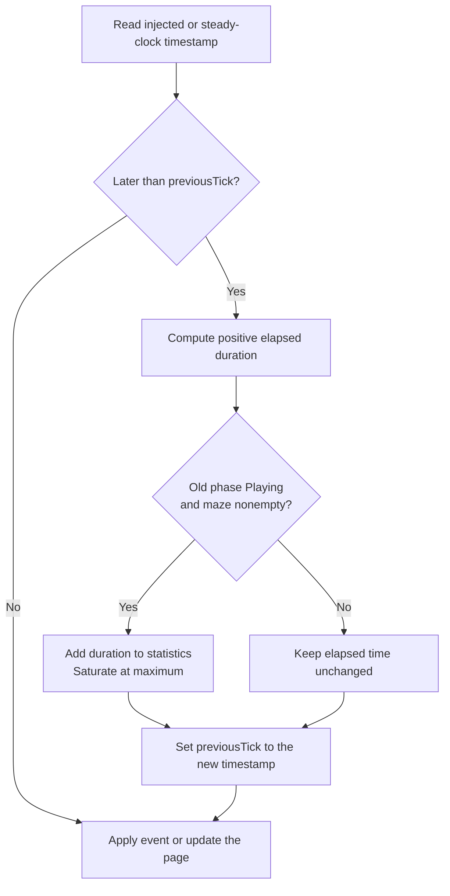
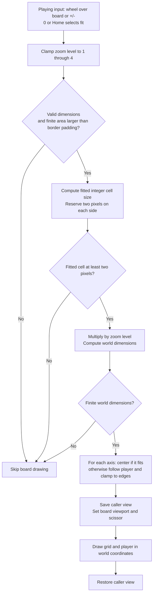
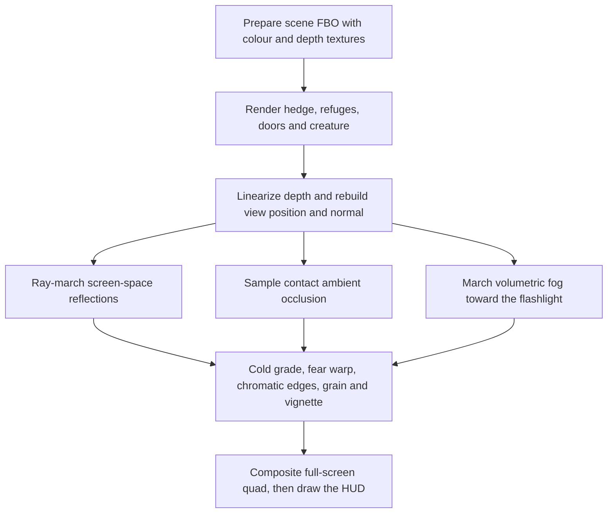

# Algorithm diagrams

These Mermaid flowcharts describe the implemented functions and render directly
on GitHub. The defense presentation also contains an editable generation diagram.
The movement and controller diagrams below also describe the earlier grid-based
interface; the first-person systems are documented in the README.

## Maze generation

Implementation: `Maze.Logic/Maze.Generation.cpp`, `generateMaze(size, seed)`.

Invalid dimensions throw before allocation. Unvisited rooms still contain Wall.
Every stack entry has even row and column indices. A completed grid contains
one Exit at `(rows - 1, cols - 1)`. A seeded selection of walls is opened after
the initial spanning tree to create loops and alternate escape routes. Time and auxiliary stack space are
O(rows * cols).

For 10 by 10, the last room is `(8, 8)`. The extension opens `(9, 8)` and `(9, 9)`
and marks `(9, 9)` Exit. For 11 by 11, the last room is already `(10, 10)`, which
becomes Exit without an extra corridor.

## Movement

Implementation: `Maze.Logic/Maze.Game.cpp`, `tryMove`.

All checks that can reject a move precede the position update. Movement takes
O(1) time and uses no grid allocation. The winning step counts once. Time is
accounted for by the controller before this operation, as shown below.

## New Game ownership

The rvalue reference parameter alone does not transfer ownership. startGame
performs the move only after layout validation succeeds.
The optional seed choice distinguishes random mode from fixed seed zero.
The controller obtains random entropy once and records the exact seed used.

## Game phases and restart

Implementation: `Maze.Logic/Maze.Game.cpp`, `Maze.Graphics/MazeApplication.cpp`.

Menu here means the empty initial/endGame phase. Menu pages and game phases are
separate: Help/Settings leave an unfinished session Paused, while returning to
the menu after victory keeps Won. Continue requires an unfinished nonempty game.
Exit then closes the window. Restart resets position/statistics and fits the
view without allocating or changing cells, current seed or next-game choices.
New Game generates and validates a replacement. Both reset the session's results.

## Elapsed time before an event or update

Implementation: `MazeApplication::updateTime` and `advanceGameTime`.

This ordering includes active time up to Escape or the winning move. It excludes
the paused interval before Continue. Equal/earlier timestamps do not move the
clock anchor backwards. The model retains fractional time; only display text
uses total minutes and seconds. Logic takes a duration and never reads a clock.

## Zoom and player tracking

Implementation: `Maze.Graphics/MazeViewport.h` and `Maze.Graphics/GameView.cpp`.

The board clips to its own area and leaves the HUD in pixel coordinates.
Continue and resize retain zoom; New Game and Restart return to fit. Zoom does
not change model cells, seed, position or successful-move count. Invalid or
overflowed geometry returns no drawable layout before GameView changes its view.

## Ray-traced lighting and fear

Implementation: `Maze.Graphics/GameView.cpp`, `assets/shaders/post.frag`.

The pass renders at the window resolution and only samples geometry already
visible in the depth buffer, so it cannot reflect objects behind the camera.
If framebuffer object entry points are unavailable the renderer draws directly,
and **T** disables the expensive ray marches without disabling the grade.

Fear is a smoothed 0..1 value built from creature proximity, darkness, pursuit
and safehouse shelter. It feeds camera sway, flashlight interference, heartbeat
rate, the post shader and the creature's door rattles. Safehouse doors are four
per refuge; the host stores their open state in one bit mask appended to the
version-9 world snapshot. Guests animate the received mask locally. A closed
door blocks the threshold, an open door does not, and the creature may slam an
open door. The hunter routes through doorway centres, strikes closed doors
three times to force them, and follows continuous stair waypoints to pursue
upstairs. Captures compare interpolated XYZ height. Repeated detections raise
vigilance, hearing range and search memory. Slots and the bar create temporary
noise targets; crouching reduces sound and detection range.
