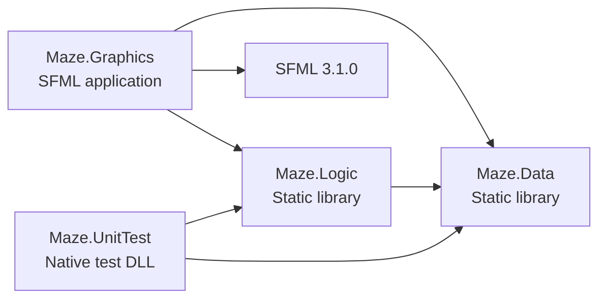

# NXRP technical documentation

This document describes the implemented C++17 Windows application. The four
Visual Studio projects form the maintained solution in `NXRP.slnx`.

## Architecture



Arrows indicate project/library dependencies. Data and Logic contain no SFML
dependency. Tests reference Data and Logic and open no game window. There are
no circular project references.

| Component | Responsibility |
| --- | --- |
| `main.cpp` | Load the font, create the window, poll events, update hover state and render frames. |
| `MazeApplication` | Own GameState and route events between gameplay and menu pages. |
| `Menu` | Display Main, How to Play, Settings and Victory pages, and return MenuAction values. |
| `GameView` | Translate arrow events into logic calls, draw cells/player and show movement feedback. |
| `Maze.Game` | Start/restart/end sessions, validate prepared layouts, apply movement and detect victory. |
| `Maze.Generation` | Create a connected random grid with an optional test seed. |
| `Maze.Settings` | Load/save validated next-game dimensions through a supplied filesystem path. |
| `SettingsPath` | Resolve the current Windows user's local app-data settings path. |
| `MazeGrid` | Own the dynamic cell array and provide checked access. |

The event loop polls available events, stops if the window closes, updates the
current page using mouse coordinates, clears, draws and displays. It limits
rendering to 60 frames per second and disables key repeat, so one arrow press
requests one move. Resizing updates the SFML view and both page layouts.

## Data model and dynamic memory

`MazeSize` holds integer `rows` and `cols`. It can represent invalid input for
validation. A nonempty MazeGrid requires both values in the inclusive range
10 through 50, so it contains between 100 and 2,500 cells.

`MazePosition` holds zero-based `row` and `col`. `MazeCell` distinguishes Wall,
Passage and Exit. `GameState` contains:

- An owned MazeGrid, initially empty.
- A selected size, initially 10 by 10, used for the next game.
- A player position, initially `(0, 0)`.
- A GamePhase: Menu, Playing, Paused or Won.

MazeGrid represents a two-dimensional grid with one **contiguous dynamic array**:

```cpp
std::unique_ptr<MazeCell[]> cells_;
// Index of a cell: row * cols + col
```

Construction validates dimensions before allocation, allocates with
`std::make_unique<MazeCell[]>`, and fills every cell with Wall. Invalid dimensions
throw `std::invalid_argument`; allocation errors propagate. `at(row, col)` checks
both coordinates and throws `std::out_of_range` for invalid or empty-grid access.
`contains(position)` offers a nonthrowing bounds check.

Copy construction and assignment are deleted. Move operations transfer the
array and leave the source with zero dimensions and no storage. Move assignment
releases the previous destination array. Destruction automatically invokes
`delete[]` through unique_ptr. `endGame` replaces the grid with an empty MazeGrid,
resets the player/phase and preserves the selected next-game size.

This ownership model avoids a separate manual deletion path for every page
transition. Its storage cost is O(rows * cols). Native tests cover moved-from
objects, replacement, self-move and out-of-range access.

## Random maze generation

`generateMaze(size, seed)` returns an owned MazeGrid. The overload without a
seed obtains entropy from `std::random_device`. The seeded form initializes
`std::mt19937`, enabling repeatability on the same generator/toolchain.

The algorithm uses an **iterative randomized depth-first search**:

1. Fill the grid with walls. Open `(0, 0)` and push it onto a vector stack.
2. Treat cells with even row and column indices as rooms. Examine the stack's
   top room for unvisited rooms two cells away in the four cardinal directions.
3. If candidates exist, choose one randomly, open the separating wall and the
   destination room, then push that room.
4. If no candidate exists, pop the current room to backtrack.
5. Repeat until the stack is empty.
6. Join the last even-indexed room to the bottom-right cell. For even dimensions,
   this opens at most two extra cells. Mark the bottom-right cell Exit.

Each newly opened room connects to an already reachable room. DFS visits the
connected rectangular room lattice, so every carved passage is reachable from
the start. The final extension connects the exit for both even and odd sizes.

Each room checks at most four neighbors. Generation takes O(rows * cols) time
and O(rows * cols) additional stack space. Iteration avoids recursive call-stack
growth. Uniform random neighbor selection does not imply uniform sampling of
all possible mazes. Random outputs can repeat. Exact seeded layouts need not
match across different standard library implementations.

See the [generation flowchart](ALGORITHMS.md#maze-generation).

## Movement and victory

`tryMove(GameState&, MoveDirection)` returns Blocked, Moved or Won. Before
changing any state, it checks that the phase is Playing, the current cell is
walkable, and the player has not already reached the exit. It computes one
candidate coordinate, checks bounds, then checks whether the target cell is
Passage or Exit. Unknown direction values also return Blocked.

A blocked request preserves position and phase. A legal request updates the
position. If the target is the bottom-right Exit, it also sets GamePhase::Won.
`hasWon` checks the actual position and cell, separately from the phase.
Each movement request takes O(1) time.

The [movement flowchart](ALGORITHMS.md#movement) shows the rejection paths.

## Session lifecycle and validation

`startGame(game, preparedMaze)` validates the replacement **before** transferring
ownership. A prepared layout must be nonempty, have a Passage at `(0, 0)`, have
exactly one Exit at bottom-right, and contain only known cell values. This
validation scans the grid in O(rows * cols) time. It checks structure; the
generator and independent reachability tests establish a path to the exit.

If validation fails, the old session and the supplied grid remain unchanged.
After successful validation, startGame moves in the prepared array, updates the
selected size to its dimensions, resets the player and enters Playing.
The GUI prepares the entire new random maze before calling startGame. Generation
or validation errors therefore preserve the old session and show an error message.

| Action | State and ownership behavior |
| --- | --- |
| New Game | Prepare/validate a replacement, release the previous owned grid on successful assignment, reset player to `(0, 0)` and enter Playing. |
| Restart maze / R | Reset the existing session's player to `(0, 0)` and enter Playing. Keep every cell, the grid allocation and the selected next-game size. |
| Escape during play | Set Paused and show the main menu. Keep the grid and player. |
| Continue | Enter Playing with the same grid/player. Available only for an unfinished Playing/Paused session. |
| Help or Settings | Display a menu page while preserving the paused session. |
| Save size | Validate and store the next-game dimensions in memory and the user's settings file. Keep the current grid. On a write failure, keep the size for this launch and show a message. |
| Back/Escape from Settings | Discard the draft by returning without applying it. |
| Reach the exit | Set Won and display the Victory page. Continue becomes unavailable. |
| Main menu after victory | Show the menu while retaining Won and its completed grid until replacement or exit. |
| Exit/window close | endGame releases the grid, resets player/phase, then closes the window. |

`hasActiveGame()` reports nonempty storage, including a completed maze. The
controller's `canContinue()` additionally checks the phase, so a completed maze
does not enable Continue. Menu page selection and GamePhase serve different
purposes and should not be treated as interchangeable state machines.

`restartGame(game)` accepts an existing Playing, Paused or Won session and
returns true after resetting its player and phase. It performs no allocation,
regeneration or settings-file I/O. It assumes the started session's prepared
layout remains valid, as established by startGame. Empty games and unstarted
or unknown phases return false without changing state. Restart takes O(1) time.

The controller exposes restart through R during play and through the Restart
maze buttons on the main menu and Victory page. R also works on those two menu
pages. It resets GameView's movement feedback after success. R on Help or
Settings has no effect, preserving a Settings draft until Save or Cancel.
The restart button remains disabled until a session exists. A completed maze
can restart even though Continue is disabled. New Game still uses the selected
dimensions and calls the random generator.

## Persistent dimension preferences

MazeApplication loads the next-game size once during construction. Its default
constructor obtains `%LOCALAPPDATA%\NXRP\settings.txt` through the Windows
`SHGetKnownFolderPath(FOLDERID_LocalAppData)` API. The returned Unicode buffer
has RAII ownership and uses `CoTaskMemFree` for cleanup. Failure to resolve the
folder disables persistence and leaves the default size available. A second
constructor accepts an explicit path for isolated controller checks.

Maze.Settings uses standard C++ file streams and filesystem operations, keeping
SFML and Windows path lookup out of Logic. The format is two whitespace-separated
integers, rows and columns. The loader rejects missing/overflowed numbers,
dimensions outside 10–50 and trailing non-whitespace data. Missing or unreadable
files also return the 10 by 10 default. Loading does not create or rewrite files.

Save size updates the next-game preference and writes a temporary sibling file.
Only after closing a complete file does it rename the replacement over the old
preferences. Invalid dimensions are rejected before any filesystem mutation.
Directory, write and rename failures return false. MazeApplication keeps the
in-memory size and explains that it applies to this launch only. Back/Escape
discards the Settings draft without writing. Continue never reloads preferences
or resizes the paused grid. New Game uses the current in-memory selection.

The application saves preferences, rather than a game session. The user can
reset dimensions by closing the game and deleting only its settings.txt file.
The file lives outside the checkout and does not belong in Git.

API references: [Windows known-folder lookup](https://learn.microsoft.com/en-us/windows/win32/api/shlobj_core/nf-shlobj_core-shgetknownfolderpath),
[C++ filesystem operations](https://learn.microsoft.com/en-us/cpp/standard-library/filesystem-functions?view=msvc-170).

## Rendering and resources

The window starts at 900 by 600 and enforces a minimum of 640 by 560. GameView
reserves space for the title, legend and status text, then computes an integer
cell size that fits both dimensions. It centers the grid in the remaining area.
It draws all cells as one triangle vertex batch and overlays the player marker.
Large grids use the same model and movement rules. Small cells omit S/E text
labels while retaining distinct exit/player colors.

The graphical build copies `assets/` beside the executable. `executableDirectory()`
uses the Windows module path instead of the process working directory. The
bundled Source Sans 3 Semibold font uses integer positioning and disables
texture smoothing. Its SIL Open Font License stays in `assets/fonts/`.
Failure to load the font reports its path and exits with code 1. Startup
exceptions also report an error and exit with code 1.

## Build and test design

`ProjectDefaults.props` sets C++17, output paths and shared compiler settings.
The three production projects use warning level 4. Maze.UnitTest retains its
Visual Studio template's PCH and warning level 3. All configurations target x64.
SFML builds statically through `Prepare-Dependencies.ps1`; generated property
sheets provide its headers, libraries and `SFML_STATIC` definition to Graphics.

The native DLL contains 81 tests in seven classes:

| Class | Tests | Coverage |
| --- | ---: | --- |
| MazeSizeTests | 10 | Bounds, rectangles and invalid values. |
| MazeGridTests | 13 | Initialization, checked access, move ownership and replacement. |
| GameStateTests | 3 | Initial state and active-grid detection. |
| MazeMovementTests | 20 | Directions, walls/bounds, invalid state, prepared layout validation and victory. |
| MazeGenerationTests | 11 | Connectivity, seeds, even/odd sizes, invalid input and playable routes. |
| MazeSessionTests | 12 | Repeated sessions, endGame, replacement failure, same-maze restart and preference preservation. |
| MazeSettingsTests | 12 | Valid/invalid files, whitespace, Unicode paths, replacement, missing directories and write failures. |

Generation tests use an independent one-cell BFS rather than the generator's
two-cell DFS. They check that every walkable cell is reachable and follow found
routes through the real tryMove API to victory. One test covers all 41 * 41 =
1,681 allowed dimension pairs. Other tests use six fixed seeds, including 0 and
the maximum 32-bit unsigned value. Tests on unseeded maps require valid results,
without assuming that consecutive random outputs always differ.

The [QA guide](../QA/README.md) records 78 distinct cases and keeps execution
methods visible. A native case has separate Debug and Release result steps.
Controller probes and live GUI observations are separate evidence types.
Test Explorer UI execution remains unverified even when VSTest console succeeds.
See [validation](VALIDATION.md) for the final local checks and limitations.

## Implemented scope and remaining limits

The current application includes the six-option graphical menu, random connected
mazes, dimension controls, arrow movement, blocked feedback, pause/Continue,
victory, same-maze restart, safe session replacement and persistent dimension
preferences. Gameplay state lasts only for the process lifetime. Seed input/replay,
elapsed time, move counters and zoom are not exposed in this version.

The remaining QA cases are a complete manual hover/click sweep, a clean
second-machine setup, and execution inside Visual Studio Test Explorer. The
spreadsheet engine checked workbook formulas and rendering; opening it in the
native Excel UI remains unverified. Presentation checks validate the exported
file and renders; they do not establish native PowerPoint behavior.

## Team responsibilities

| Participant | Confirmed responsibility |
| --- | --- |
| RMKolibarov24 | Solution setup, dependency integration, documentation and defense materials. |
| HAMihaylov24 | Dynamic data model, movement/game rules, random generation implementation and session/resource lifecycle. |
| PDKapralev24 | SFML menu, board rendering, keyboard integration and screen transitions. |
| NKPeshev24 | Native test coverage and QA review. |

These describe development areas and review ownership. Git commit authorship and
the workbook's individual execution records remain separate records.
